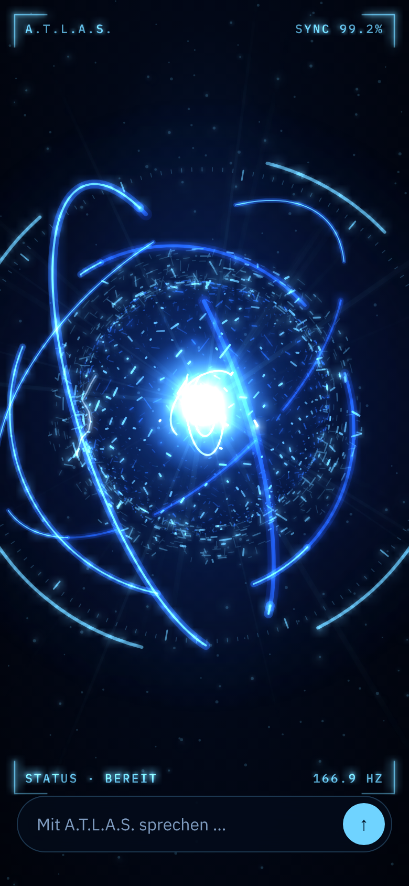

# ATLAS – Technische Planung & Stand



## Zielsystem
- **Geräte:** iPhone 15 Pro oder neuer (iOS 26) und MacBook mit Apple-Chip – **eine** gemeinsame SwiftUI-App
- **Mindestversionen:** iOS 17, macOS 14
- **Entwicklung:** Xcode 26, Swift, SwiftUI, SwiftData
- **KI:** Claude API (Anthropic), austauschbar über das Protokoll `AIProvider`

## Architektur

```
 ┌───────────────────── SwiftUI-Oberfläche ─────────────────────┐
 │ AtlasFaceView · MainView · Einstellungen · Gedächtnis ·        │
 │ Aufgaben · Berechtigungen · Aktivitäten · Verlauf              │
 └──────────────▲───────────────────────────┬─────────────────────┘
                │ beobachtet                 │ Aktionen
   Siri/Kurzbefehle ─► IntentRouter ─► ┌──────▼──────────────┐ ◄─ Mitteilungen (Tagesübersicht)
                                       │ ConversationEngine   │  Bereitschaft („Atlas“) → Zuhören →
                                       │                      │  Denken (+ Werkzeuge) → Sprechen
                                       └──┬───────┬───────┬───┘
                                          │       │       │
                       SpeechRecognizer   │   AIProvider  │  SpeechSynthesizer
                       (on-device)        │   (Claude)    │  (satzweise, Wort-Takt → Mund)
                                          │       │
                                          │   AtlasToolbox ── EventKit · Contacts · CoreLocation ·
                                          │   (mit Bestätigung)  Apple Karten · Nachrichten/Mail · Gedächtnis
                                          │
                         SwiftData: Verlauf · Gedächtnis · Aktivitäten (iCloud-fähig) · Schlüsselbund: API-Schlüssel
```

**Wichtige Entscheidungen**
- **Streaming + Satz-Zerlegung:** Sobald ein Satz fertig ist, spricht ATLAS ihn – geringe gefühlte Wartezeit.
- **Werkzeuge über Claude Tool Use:** Claude entscheidet, wann Kalender, Erinnerungen usw. gebraucht werden; ATLAS führt sie lokal aus und schickt nur das Ergebnis zurück. Werkzeug-Eingaben werden gestreamt (`eager_input_streaming`) und vor der Ausführung geprüft.
- **Sensible Aktionen:** Nachrichten und Löschen im Gedächtnis erfordern immer eine Bestätigung (Karte + „Ja/Nein“ per Stimme). Nachrichten werden nie automatisch gesendet.
- **Wake-Word:** Kontinuierliche Spracherkennung ausschließlich **auf dem Gerät**, nur im Vordergrund; die Erkennung startet etwa jede Minute neu (Systemgrenze). Im Hintergrund wird das Mikrofon immer abgeschaltet.
- **ATLAS-Kern (Standard):** `AtlasHologramView` – SwiftUI-`Canvas` mit additiver Lichtmischung. Start-Sequenz rein zeitbasiert (Flug auf analytischen Wirbelbahnen mit Leuchtspuren → Einrasten im Schriftzug, abgetastet per `ImageRenderer` aus der mitgelieferten Schrift Orbitron, SIL OFL → Spiral-Zerfall in die Kugel). Kern: Plasmakern, 3D-Fibonacci-Kugel (1.600 Lichtstreifen), drei Gyroskop-Ringe mit Vorder-/Rückseite, Energieblitze (pro Zeitfenster deterministisch), Splitter-Schale, Lichtstrahlen, Staub, HUD-Skala und Eckrahmen. Bloom über eine weichgezeichnete Ebene (`drawLayer` + `.blur`) nur für die hellsten Elemente. Pfade nach Helligkeit gebündelt.
- **Darstellung:** SwiftUI `Canvas` mit 60 fps, pausiert automatisch, wenn die App nicht sichtbar ist; respektiert „Bewegung reduzieren“. Sprechrhythmus aus den Wort-Ereignissen der Sprachausgabe.
- **Gedächtnis:** Nur ausdrücklich Gespeichertes; wird bei jeder Anfrage in die Systemanweisung eingefügt; vollständig einsehbar, bearbeitbar, löschbar.
- **Denkblöcke:** Innerhalb eines Werkzeug-Durchlaufs werden sie unverändert zurückgegeben (Pflicht); zwischen Gesprächszügen speichert ATLAS nur den Text. Das hält Anfragen klein und robust.
- **Ausweichmodell:** Bei fälschlicher Ablehnung übernimmt serverseitig automatisch ein anderes Modell (`fallbacks: "default"`).
- **Mac:** Native macOS-App aus demselben Code (keine Catalyst-Kopie); Unterschiede gekapselt in `Core/Platform/Platform.swift`; Sandbox-Freigaben in `Config/ATLAS-macOS.entitlements`.
- **iCloud:** Alle Datenmodelle sind CloudKit-kompatibel. Sobald die iCloud-Capability aktiviert ist (bezahltes Entwicklerkonto), synchronisiert SwiftData automatisch und Ende-zu-Ende in Ihrem privaten iCloud.

## Bewertung der KI-Optionen

| Option | Vorteile | Nachteile | Entscheidung |
|---|---|---|---|
| Claude API | Sehr gutes Deutsch, starkes Denken, Bild- und PDF-Verständnis, Websuche, Werkzeugnutzung | Laufende Kosten, Internet nötig | **Hauptmodell** |
| OpenAI API | Ebenfalls stark | Zweiter Anbieter, zweite Abrechnung | Über `AIProvider` nachrüstbar |
| Lokales Modell (Apple Foundation Models, iOS 26) | Kostenlos, offline, privat | Deutlich schwächer, keine Websuche | Später für einfache Offline-Fragen |
| Hybrid | Beste Mischung | Mehr Komplexität | Möglicher nächster Schritt |

## Was Apple erlaubt – und was nicht

| Wunsch | Realität | Umsetzung in ATLAS |
|---|---|---|
| „Atlas“ rufen, App geöffnet | ✅ | Wake-Word im Vordergrund (Ohr-Symbol) |
| „Atlas“ rufen, App geschlossen / gesperrt | ❌ kein Dauer-Mikrofon im Hintergrund | „Siri, starte ATLAS“, Action-Button, Kurzbefehle |
| Siri-Integration | ✅ App Intents | Starten, Fragen (Antwort ohne App), Tagesübersicht, Morgen planen |
| Kalender, Erinnerungen, Kontakte, Standort | ✅ mit Erlaubnis | Werkzeuge in `Core/Tools` |
| Fotos, Kamera, Dateien | ✅ Auswahl durch Nutzer | Anhänge (Foto, Kamera, PDF) |
| Nachrichten selbst senden | ⚠️ nur durch Nutzer | Entwurf + Bestätigung, Senden durch Nutzer |
| Dauerhafte Hintergrundarbeit | ❌ | Mitteilungen zur gewählten Uhrzeit; Übersicht beim Öffnen |

## Stand der Phasen

| Phase | Inhalt | Stand |
|---|---|---|
| 1 | SwiftUI-App, Claude, Sprachgespräche | ✅ |
| 2 | Animierter 3D-Kern mit HUD, Reaktion auf Stimme und Sprechen | ✅ |
| 3 | Wake-Word im Vordergrund, Siri, Kurzbefehle, Action-Button | ✅ |
| 4 | Kalender, Erinnerungen, Kontakte, Karten, Standort, Fotos, Kamera, PDFs, Nachrichtenentwürfe | ✅ |
| 5 | Gedächtnis, Aufgabenübersicht, Tagesplanung, Tagesübersicht/Rückblick, Aktivitätsprotokoll | ✅ |
| 6 | Mac-App, iCloud-Synchronisierung vorbereitet | ✅ Mac · ⚙️ iCloud nach Aktivierung der Capability |

## Mögliche nächste Schritte
- **Metal-Partikel:** 20.000+ Punkte mit echtem Bloom über einen Metal-Shader, falls noch mehr Tiefe gewünscht ist.
- **Apple Watch:** Watch-App mit „ATLAS fragen“ per Diktat und Tagesübersicht (eigenes watchOS-Target, nutzt die gleiche Claude-Anbindung).
- **Widget / Steuerelement:** Kontrollzentrum- und Sperrbildschirm-Knopf „ATLAS starten“ (WidgetKit-Erweiterung).
- **Premium-Stimme:** Optional eine Cloud-Stimme (z. B. ElevenLabs/OpenAI TTS) für einen noch natürlicheren britischen Butler.
- **Eigener Server:** Für Push-basierte Hinweise (z. B. „In 30 Minuten losfahren“) und um den API-Schlüssel ganz vom Gerät zu nehmen.
- **Lokales Modell** für einfache Fragen ohne Internet.

## Sicherheit & Datenschutz
- Mikrofon nur sichtbar aktiv (roter bzw. hellblauer Punkt, System-Mikrofonanzeige), nie im Hintergrund.
- Wake-Word-Erkennung nur auf dem Gerät; nichts verlässt das Gerät, bevor „Atlas“ gesagt wurde.
- Berechtigungen erst bei Bedarf, mit Begründung; Übersicht unter *Einstellungen → Berechtigungen*.
- API-Schlüssel nur im Schlüsselbund, nie im Code, nie synchronisiert.
- Aktivitätsprotokoll jeder ausgeführten Aktion.
- Sensible Aktionen nur nach Bestätigung.
- Transparenz in den Einstellungen, welche Daten an Anthropic gehen.
